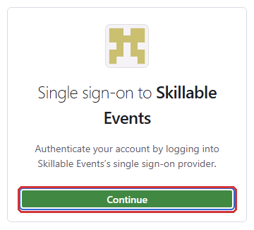
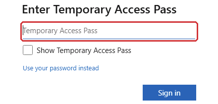
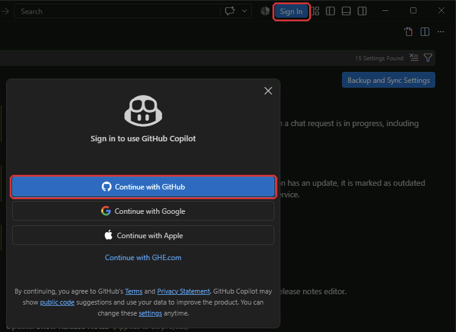
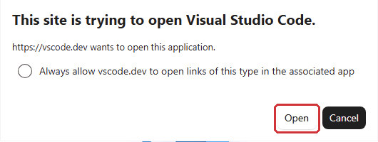
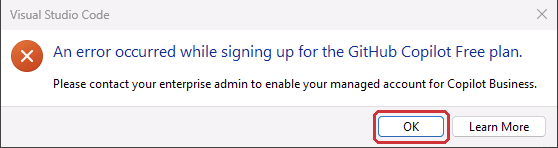
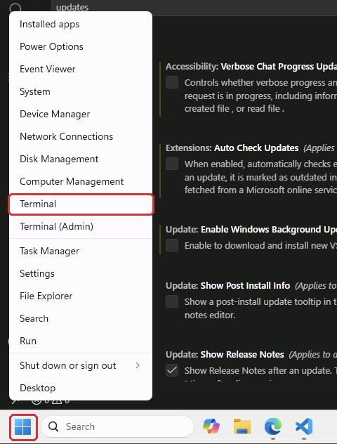
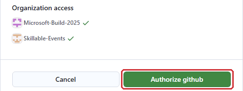
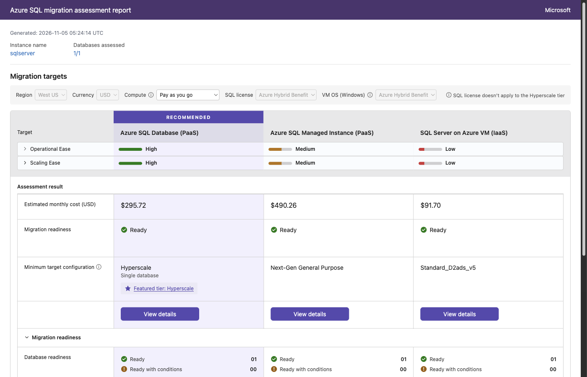
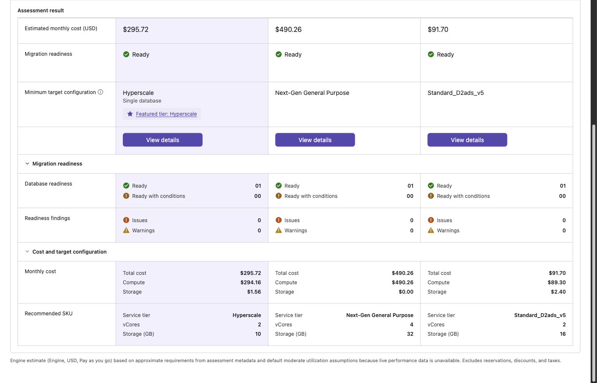

# Modernize application code with GitHub Copilot

Read an application assessment, start a rulebook-guided modernization, and check the result rather than trusting a successful agent response.

This is the **45-minute .NET track** for **Caldova Bank**. It uses prepared files on the assigned VM and does not depend on an Azure Migrate exercise. The later **SRE Agent** module uses a different workload, Caldova Retail Co.

| Stage | Time | Your result |
|---|---|---|
| Assess | 8 minutes | Identify the sign-in provider and its database risks |
| Plan | 12 minutes | Load shared rules, start a plan, and review the prepared plan |
| Execute and verify | 25 minutes | Start execution and check prepared code, tests, and routes |

**Where the files are:** `C:\lab\caldova\modules` has one folder per exercise, each with a `start` folder (before) and a `finish` folder (a prepared after state). `module-03-execute\final\dotnet` is a separate, validated end state for comparison. Do not copy `final` over `finish`; `finish` contains a deliberately flawed example to review.

**Long-running commands:** Planning and execution take several minutes. Start each run when the guide says to, then continue with the prepared results. You do not need to wait.

**Notes:** Label each result as one of these:

- **My run:** you ran it and saw the result.
- **Prepared example:** supplied with the lab.
- **Pending:** you started it and it has not finished.
- **Not run:** skipped or blocked.

---

## Get ready

### Sign in to GitHub in Edge and VS Code

These are the **Start > GitHub and Copilot** steps from the lab manual. If you already completed them, skip to [Entering commands](#entering-commands). Do everything inside the VM.

1. **Windows:** If the VM shows a **LabUser** password screen, select the password box. On the **Resources** tab, under **Win11-Pro-Base**, select the **Password** value to type it into the VM, then press **Enter**.
2. **GitHub in Edge:** Open Microsoft Edge in the VM and go to `https://github.com/enterprises/skillable-events/sso`.
   1. On **Single sign-on to Skillable Events**, select **Continue**.

      

   2. On the Microsoft sign-in page, enter **Resources > Azure Portal > Username** and select **Next**. Do not use the VM's **LabUser** username.
   3. On **Enter Temporary Access Pass**, enter **Resources > Azure Portal > TAP** (not either **Password** value) and select **Sign in**.

      

   4. Answer the pop-ups: **Stay signed in?** select **Yes**. **Sign in to Microsoft Edge** select **No, thanks**. If Edge offers to save a password, select **Not now**. You can ignore a Windows Firewall notification.
   5. Leave this Edge window open.
3. **VS Code:** Open Visual Studio Code from the taskbar. It may open on a Settings tab; you can close it.
   1. Select **Sign In** at the top right of the title bar, then select **Continue with GitHub**. Do not select **Continue with GHE.com**.

      

   2. Edge opens. On the account page select **Continue**, then scroll down and select **Authorize Visual-Studio-Code**.
   3. When Edge says **This site is trying to open Visual Studio Code.**, select **Open**, not the darker **Cancel** button.

      

**Copilot can take 20-40 minutes to become available after the lab launches.** Until then, VS Code may show the message below. Select **OK** and continue; the assessment and rulebook exercises (modernization steps 1 and 2) do not need Copilot. [Skillable advises allowing 20-40 minutes for GitHub/Copilot access to populate](https://github.com/microsoft/ignite26-LAB720/issues/9#issuecomment-6317108726).



### Entering commands

- Select inside the Terminal window in the VM, then select **Type** on a code block.
- **Type** enters text slowly. Wait until the last line appears, then press **Enter**; it does not press Enter after the last line.
- Long lines are cut off in the instructions pane, but **Type** enters the whole command.
- Keep the lab open in only one browser tab, and keep that tab visible. If the VM screen goes blank or shows the **LabUser** password screen, see [If something did not work](#if-something-did-not-work).
- When VS Code asks **Do you trust the authors of the files in this folder?**, select **Yes, I trust the authors**. Do this only for the lab folders in this guide.

### Open Terminal

In the VM, right-click **Start** and select **Terminal**. It opens **Windows PowerShell**. Run every command in this guide there.



### Sign in to GitHub CLI

GitHub CLI is signed out on a new VM, even after you sign in to Edge and VS Code, because each keeps its own sign-in.

```powershell
gh auth login --web --git-protocol https --clipboard
```

1. At **Authenticate Git with your GitHub credentials? (Y/n)**, press **Enter**.
2. Terminal shows a one-time code and copies it to the clipboard. Press **Enter** to open the browser.
3. In Edge, select **Continue** on the account page.
4. Select the first code box, press **Ctrl+V** (or type the code shown in Terminal), and select **Continue**.
5. Scroll to the bottom of the page and select **Authorize github**.

   

6. When you see **Congratulations, you're all set!**, return to Terminal. It shows **Logged in as** and the lab account name.

### Check the tools

```powershell
git --version
gh auth status
Test-Path C:\lab\caldova\modules
modernize --version
dotnet --list-sdks
```

**Before you continue:** `gh auth status` shows that you are logged in to github.com, the folder check returns `True`, and you see a Modernize version and a `10.0` .NET SDK. If something is missing, ask the facilitator. Do not install software, change permissions or use a personal account.

---

## 1. Read the assessment

**Step 1 of 6 - About 8 minutes**

Identify the **provider** (the service other applications call) before its **consumer** (the application that depends on it). Here, CaldovaLoanPortal signs in through CaldovaAuthGateway.

This lab uses a prepared assessment. Do not run a new assessment or change the assessment inputs.

1. Open the prepared report folder:

   ```powershell
   cd C:\lab\caldova\modules\module-01-assess\start\.github\modernize\assessment-prebuilt
   explorer .
   ```

2. In File Explorer, open the `reports-...` folder (its name ends in a date and time), then open `index.html`. If Windows asks which app to use, select **Microsoft Edge > Just once**. Review the portfolio.
3. Back in Terminal, open the same folder in VS Code:

   ```powershell
   code .
   ```

   In the VS Code **Explorer**, expand `reports-...` > `repos` > `CaldovaAuthGateway` > `facts`. Open `data-architecture.md` and `configuration-inventory.md`, and find:

   - `System.Data.SqlClient`
   - SQL-login settings (`DB_USER` and `DB_PASSWORD`)
   - Certificate-validation settings

   To search a file, press **Ctrl+F**.

4. Review the Azure SQL readiness result for the Caldova database (`CaldovaBankDB`). The facilitator ran this SQL Server assessment before the lab, so it is not in the VM. Read it here:

   The report identifies the SQL Server as `sqlserver` and shows one database assessed; that database is `CaldovaBankDB`.

   

   

   Check that all three Azure SQL targets show **Ready** with 0 issues and 0 warnings, and that **Azure SQL Database** is the recommended target. The monthly costs are estimates based on this report's configuration assumptions; no live performance data was collected. They are separate from the cost estimate in the prepared application assessment, so compare readiness and target recommendations rather than the dollar amounts.

The facts in step 3 come from application code, and the readiness result comes from the database schema. Neither proves that a connection works or that a migration completed. Use the facts and source when a topology graph omits a relationship.

**Before you continue:** Note why the gateway comes first, two database-connection risks its plan must address, and the Azure SQL target the readiness report recommends.

---

## 2. Use the shared rulebook and add the PII skill

**Step 2 of 6 - About 4 minutes**

A **rulebook** tells the agent **what** standards to meet. A **skill** describes **how** to perform a task. The PII-masking skill keeps personally identifiable information (PII), such as customer names and account numbers, out of logs.

All learners use the same [Caldova workshop rulebook](https://github.com/ayangupt/ignite26-caldova-rulebook). **Do not create your own rulebook repository.** Its charter, policies and targets are teaching examples, not Microsoft production policy.

1. Go to the planning workspace and check its configuration:

   ```powershell
   cd C:\lab\caldova\modules\module-02-plan\start
   Get-Content .github\modernize\config.json
   ```

   The output should include `"rulebook": true` and `"portfolio_url": "https://github.com/ayangupt/ignite26-caldova-rulebook"`. Modernize reads this file from the folder where it starts, so each Modernize command in this guide starts in a module folder. A local `rulebook` folder alone does not load the rules.

2. Open the workspace in VS Code:

   ```powershell
   code .
   ```

   Skim the local reading copies in the `rulebook` folder: `charter.md`, `policies.md` and `targets.md`.

3. Copy the PII skill into the gateway. The command skips the copy if the skill is already there:

   ```powershell
   $skills = 'apps\CaldovaAuthGateway\.github\skills'
   New-Item -ItemType Directory -Force $skills | Out-Null
   if (-not (Test-Path "$skills\pii-masking")) { Copy-Item skills\pii-masking $skills -Recurse }
   Get-ChildItem "$skills\pii-masking"
   ```

   The list should include `SKILL.md`. Open it in VS Code to see what the skill asks the agent to do.

**Before you continue:** You can explain the difference between the shared rules and the PII skill, and the config points to the shared rulebook. If the config is missing, ask the facilitator, review the prepared plan in step 3, item 3, and record live planning and execution as **not run**. Do not substitute a local folder or invent a URL.

---

## 3. Start the plan, then review the prepared plan

**Step 3 of 6 - About 8 minutes**

Start a live plan for the gateway, then review the prepared plan while it runs.

1. In the same Terminal tab, start planning. The command reads the supplied goal from `goals\dotnet.txt` and adds local-only limits. `--no-tty` runs it without menus or questions:

   ```powershell
   cd C:\lab\caldova\modules\module-02-plan\start
   $goal = Get-Content goals\dotnet.txt -Raw
   $goal += ' Keep the plan local. Do not deploy, provision resources, grant access, push changes or install tools.'
   modernize plan create $goal `
     --source "$PWD\apps\CaldovaAuthGateway" `
     --plan-name caldova-dotnet-modernization `
     --language dotnet `
     --model auto `
     --no-tty
   ```

2. Look for **`Rulebook loaded (3 files)`**, then leave the run going. This message means the live command read the three shared rulebook files; it does not prove the plan or code complies. When the run finishes, `apps\CaldovaAuthGateway\.github\modernize\caldova-dotnet-modernization` should contain `plan.md`, `rulebook-compliance.md` and `.metadata\rulebook-metadata.json`; check that the metadata's source URL is the shared rulebook.

   If the run returns HTTP 403 or another Copilot access error, Copilot is not ready for your account yet. Tell the facilitator, continue with the prepared plan below, and record live planning as **not run**.


*Expected CLI message: `SUCCESS: Rulebook loaded (3 files)`.*

3. Open a second Terminal tab: select **+** in the Terminal tab bar. In the new tab, open the prepared plan:

   ```powershell
   cd C:\lab\caldova\modules\module-03-execute\start
   git switch modernization/dotnet
   code apps\CaldovaAuthGateway
   ```

   In the VS Code **Explorer**, expand `.github` > `modernize` > `caldova-dotnet-modernization`. Open `plan.md` and press **Ctrl+Shift+V** to preview it. Open `rulebook-compliance.md` too if it is there. The prepared plan is on the `modernization/dotnet` branch, not `main`; its reports describe an earlier rehearsal, not today's run. If a report is missing, record that gap rather than create substitute evidence.


*1. Open the plan and compliance report. 2. Find the .NET 10 target. 3. Check the managed-identity requirement.*

4. Match the rules to tasks: .NET 10; managed-identity database access; validated TLS; no PII in logs; supported libraries; compatible public routes and `/WhoAmI.ashx`; health checks and a compliant Dockerfile.

**Before you continue:** You can explain how the plan covers the rules and where the PII skill is used. If the live plan is still running, record **pending** and continue. If native loading fails, stop that run, tell the facilitator and review the prepared results instead.

---

## 4. Start the prepared execution

**Step 4 of 6 - About 3 minutes**

Run the remaining gateway tasks in the separate execution workspace, not in your planning workspace.

1. Check the first Terminal tab. If the planning run is still going, record **pending** and stop it with **Ctrl+C**.
2. In the second tab, confirm the execution workspace has the same shared-rulebook settings as step 2:

   ```powershell
   cd C:\lab\caldova\modules\module-03-execute\start
   Get-Content .github\modernize\config.json
   ```

3. In the VS Code window from step 3, open `.github` > `modernize` > `caldova-dotnet-modernization` > `.metadata` > `tasks.json`. The runtime-upgrade and Web Forms-conversion tasks should already show `"status": "success"`. They are **prepared starting state**, not work you just performed.


*1. Locate `tasks.json`. 2-3. Confirm `success` for the runtime upgrade and Web Forms conversion.*

4. In the second tab, start execution. Use this command rather than starting a second run from VS Code:

   ```powershell
   modernize plan execute "Execute all remaining tasks, starting with the first unfinished task. Do not stop after one task. Do not run the deployment task, provision resources, grant access, push changes or install tools." `
     --plan-name caldova-dotnet-modernization `
     --source "$PWD\apps\CaldovaAuthGateway" `
     --model auto `
     --no-tty
   ```

**Before you continue:** Check for **`Rulebook loaded (3 files)`** in this execution too. If it is absent, stop and ask the facilitator; do not assume the planning workspace's settings carried over. Otherwise leave the tab running and move on **without waiting**. If task states or tools differ, use the prepared review and record execution as **not run**.

---

## 5. Review a finished application

**Step 5 of 6 - About 10 minutes**

Inspect the prepared result for faults that a successful build or agent response would miss.

1. Leave the execution running. Open a third Terminal tab (**+**) and run:

   ```powershell
   cd C:\lab\caldova\modules\module-03-execute\finish
   git switch modernization/dotnet
   git --no-pager diff --stat main -- apps/CaldovaLoanPortal
   code apps\CaldovaLoanPortal
   ```

   The diff lists the portal files that changed.

2. In VS Code, find the ASP.NET Core replacement for the old Web Forms code. Compare its database settings and public routes with the rulebook.
3. Identify two gaps. Press **Ctrl+Shift+F** and search the portal for:

   - `mono:6.12`: the portal's Dockerfile still uses the legacy `FROM mono:6.12` base image.
   - `WhoAmI.ashx`: how the portal recognizes users through the gateway's `/WhoAmI.ashx` response. A green build does not prove this sign-in contract works.

4. Spend about four minutes on the **separate** final state:

   ```powershell
   code C:\lab\caldova\modules\module-03-execute\final\dotnet
   ```

   Confirm the three apps target .NET 10; compare the portal's Microsoft-based, non-root Dockerfile; and read `VALIDATION.md`. This frozen snapshot's evidence is not output from your current agent run. Do not rerun its full SQL-backed suite, rebuild containers or deploy during this lab.

**Before you continue:** Note the review gaps and how the final snapshot addresses them. Keep Azure access, signed-in behavior and any new-rulebook execution separate from that historical evidence. Do not overwrite `finish` with `final`.

---

## 6. Validate the provider

**Step 6 of 6 - About 12 minutes**

Build, test and run the **prepared gateway** locally. Apply the same checks to your live result only if it finishes.

1. In the third tab, build and run the test project:

   ```powershell
   cd C:\lab\caldova\modules\module-03-execute\finish\apps\CaldovaAuthGateway
   dotnet build
   dotnet test Tests\CaldovaAuthGateway.Tests.csproj
   ```


*1. Look for `Build succeeded`. 2. Check `failed: 0` in the test summary.*

2. Inspect the code for an SDK-style .NET 10 project; `Microsoft.Data.SqlClient` with identity-based authentication and validated TLS; structured logs using PII masking; and preserved public routes.
3. In the same tab, start the app without a database, using local-only placeholder values. Leave it running:

   ```powershell
   $env:DB_HOST = 'localhost'
   $env:DB_NAME = 'CaldovaBankDB'
   $env:APPLICATIONINSIGHTS_CONNECTION_STRING = 'InstrumentationKey=00000000-0000-0000-0000-000000000000;IngestionEndpoint=http://localhost/'
   dotnet run
   ```

4. Open a fourth Terminal tab (**+**) and check the routes:

   ```powershell
   curl.exe -i http://localhost:8080/health
   curl.exe -i http://localhost:8080/WhoAmI.ashx
   ```

   Expect HTTP 200 from both, and `{"authenticated":false}` from `/WhoAmI.ashx`. Then go back to the third tab and press **Ctrl+C** to stop the app.


*1. `/health`: HTTP 200 and `OK`. 2. `/WhoAmI.ashx`: HTTP 200 and `{"authenticated":false}`.*

5. If your live execution finished, repeat the checks in its gateway under `module-03-execute\start`. If it is still running, record **pending**; if skipped, record **not run**. Do not launch a duplicate.

**Before you continue:** Record your build/test and route results separately from prepared evidence. These routes do not test database-backed login or Azure telemetry delivery. The VM, Azure and TAP credentials are **not application test-user credentials**. Missing DB/app-login inputs mean **not verified**, not an invitation to guess credentials or create resources.

---

## Finish

In your notes, answer:

- Why did the sign-in provider come before its consumer?
- Which rules and skill guided the plan, and where did you see native loading?
- What did you personally verify, what came from prepared examples, and what remains pending or not run?

If you used the review-only fallback, say so; it does not complete the live hands-on outcomes. Stop local app servers, leave unfinished agent work identified, and follow the facilitator's handoff. Do not reset the shared lab.

**Continue to SRE Agent** in the full lab manual, using its own workload and resources.

### If something did not work

| Symptom | Next action |
|---|---|
| The VM shows the **LabUser** password screen | Select the password box. On **Resources**, under **Win11-Pro-Base**, select the **Password** value to type it, then press **Enter** |
| The VM screen goes white or blank, or keeps reconnecting | Keep the lab open in only one browser tab and keep that tab visible; close any other tab or window with this lab. Wait a few seconds for it to reconnect, then sign in to Windows again if asked |
| Nothing happens after **Type** finishes | **Type** does not press Enter after the last line. Select the Terminal window and press **Enter** |
| You cannot find an **Authorize** button | Scroll to the bottom of the GitHub page |
| `gh auth status` says you are not logged in | Run the GitHub CLI sign-in in **Get ready** |
| Copilot returns HTTP 403, or VS Code says the managed account needs Copilot Business | Copilot access can take 20-40 minutes after launch. If it still fails when you reach step 3, ask the facilitator to check the assigned account's Copilot access. Successful SSO and `gh auth status` do not prove access. Use the prepared review only, marked **not run**, rather than switching to a personal account |
| Lab folder or tool missing | Ask the facilitator; do not install software or use personal access. The prepared VM's tool list is in [Infrastructure](../infra/README.md) |
| The prepared report still says `ZavaAuthGateway` | Ask the facilitator to check the image; do not rename files yourself |
| CLI rejects the model | Confirm the command includes `--model auto`; VS Code's model picker is separate |
| Rulebook not loaded | Check the working folder's `.github\modernize\config.json`, the shared URL and `gh auth status`; stop live work and ask the facilitator |
| Agent takes too long | Review the prepared result and record your run as pending |
| Git output fills the terminal | Press `q` if a pager opened; use the documented `--no-pager` commands |
| Build passes but login fails | Inspect the gateway/portal contract and required DB/app-user setup |
